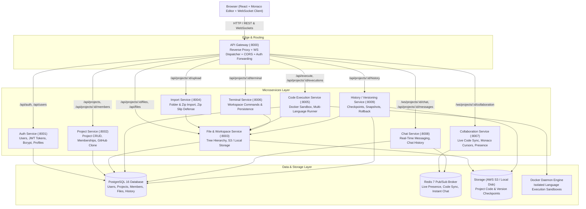

# Mirage IDE - Microservices Architecture Documentation

## 1. System Overview

Mirage IDE is built on an enterprise-grade, distributed microservices architecture consisting of **10 specialized backend microservices**, an **API Gateway**, a **PostgreSQL relational database**, a **Redis Pub/Sub broker**, and a **React + Monaco Editor single-page frontend application**.



---

## 2. Microservice Registry & Port Allocation

| Microservice | Port | Protocol | Primary Responsibilities | Data Store / Dependencies |
| :--- | :---: | :---: | :--- | :--- |
| **API Gateway** | `8000` | HTTP / WS | Unified ingress, route proxying, request/response streaming, CORS, error handling | Upstream Microservices |
| **Auth Service** | `8001` | HTTP | User registration, authentication, bcrypt hashing, JWT access tokens, profile | PostgreSQL (`users`) |
| **Project Service** | `8002` | HTTP | Project metadata CRUD, RBAC (`OWNER`, `EDITOR`, `VIEWER`), GitHub repo cloning | PostgreSQL (`projects`, `project_members`) |
| **File Service** | `8003` | HTTP | Project file tree, CRUD, Monaco file contents, S3 / local disk persistence | PostgreSQL (`files`), Storage (S3 / Local) |
| **Import Service** | `8004` | HTTP | Local folder upload, ZIP archive upload, path traversal scanning, Zip Slip defense | `file-service` |
| **Execution Service** | `8005` | HTTP | Multi-language execution (Python, JS, Java, C, C++), Docker sandbox, execution logs | Docker Daemon, PostgreSQL (`execution_history`), `file-service` |
| **Terminal Service** | `8006` | HTTP | Integrated terminal commands, persistent workspace directory syncing | `file-service`, Local workspace disk |
| **Collaboration Service** | `8007` | WebSocket | Real-time Monaco code editing sync, remote cursor tracking, member presence | Redis Pub/Sub, `project-service` |
| **Chat Service** | `8008` | HTTP / WS | Project chat room WebSocket broadcast, persistent chat history | PostgreSQL (`chat_messages`), Redis Pub/Sub |
| **History Service** | `8009` | HTTP | Project snapshot checkpoints, version history, rollback restoration | PostgreSQL (`project_versions`), Storage, `file-service` |
| **PostgreSQL** | `5432` | TCP | Relational persistence for application metadata | Data Volume |
| **Redis** | `6379` | TCP | Real-time WebSocket pub/sub message broker & cache | Data Volume |
| **Frontend** | `5173` | HTTP | React SPA, Monaco Editor, Lucide Icons, Glassmorphic UI | `api-gateway` (:8000) |

---

## 3. Communication Patterns

### Ingress & Reverse Proxying
- The Frontend connects exclusively to the **API Gateway** on Port `8000`.
- The Gateway inspects incoming request paths and transparently routes:
  - `/api/auth/*` and `/api/users/*` &rarr; `auth-service:8001`
  - `/api/projects/*` &rarr; `project-service:8002`
  - `/api/projects/{id}/files` and `/api/files/*` &rarr; `file-service:8003`
  - `/api/projects/{id}/upload*` &rarr; `import-service:8004`
  - `/api/execute` and `/api/projects/{id}/executions` &rarr; `execution-service:8005`
  - `/api/projects/{id}/terminal` &rarr; `terminal-service:8006`
  - `/api/projects/{id}/messages` &rarr; `chat-service:8008`
  - `/api/projects/{id}/history*` &rarr; `history-service:8009`
  - `/ws/projects/{id}/collaboration` &rarr; `collaboration-service:8007`
  - `/ws/projects/{id}/chat` &rarr; `chat-service:8008`
- Hop-by-hop headers are cleanly filtered, while authorization headers (`Authorization: Bearer <jwt>`) are forwarded intact.
- Upstream network errors and timeouts are translated into standardized `502 Bad Gateway` and `504 Gateway Timeout` JSON responses.

### Inter-Service Communication
1. **Token Validation**: Downstream services import `shared.common.auth` to decode signed JWT claims (`sub`, `email`, `name`) without requiring extra database calls.
2. **Permission Checks**: When a user attempts file modification, code execution, or version restoration, the service queries `project-service` via internal HTTP (`GET /projects/{id}/role?user_id={uid}`).
3. **File Provisioning**: `execution-service` and `history-service` fetch raw project files via internal HTTP (`GET /projects/{id}/files/raw`) from `file-service`.
4. **Starter Generation**: When `project-service` creates a project, it triggers `file-service` (`POST /projects/{id}/starter`) to generate starter files (`main.py`, `README.md`).

---

## 4. Security & Isolation

1. **Docker Container Sandbox Rules**:
   - `--network none`: Container network access is completely disabled to eliminate SSRF and data exfiltration vulnerabilities.
   - `--memory 128m`: RAM is capped at 128 MB per execution.
   - `--cpus 0.5`: CPU utilization is restricted to 0.5 core.
   - Timeout Enforcement: Executions are hard-terminated after 10 seconds.
   - Non-root user: Containers run with unprivileged UID `1000:1000`.
2. **Zip Slip & Path Traversal Protection**:
   - `import-service` and `file-service` sanitize all path segments, rejecting any relative paths containing `..` or `.`.
3. **Password Security**:
   - Password hashes use bcrypt with automatic salting via passlib. Plaintext passwords are never stored.

---

## 5. Directory Structure

```
CloudeIde/
├── services/
│   ├── api-gateway/            # Port 8000
│   ├── auth-service/           # Port 8001
│   ├── project-service/        # Port 8002
│   ├── file-service/           # Port 8003
│   ├── import-service/         # Port 8004
│   ├── execution-service/      # Port 8005
│   ├── terminal-service/       # Port 8006
│   ├── collaboration-service/  # Port 8007
│   ├── chat-service/           # Port 8008
│   └── history-service/        # Port 8009
├── shared/
│   ├── common/
│   │   ├── auth.py             # JWT claims, bcrypt, FastAPI dependencies
│   │   ├── config.py           # Shared Pydantic BaseSettings
│   │   └── logging.py          # Structured service logging
│   └── setup.py                # Installable shared package
├── frontend/                   # React 18 + Vite + Monaco Editor
├── docker-compose.yml          # Full multi-container orchestration
├── .env.example
└── README.md
```
